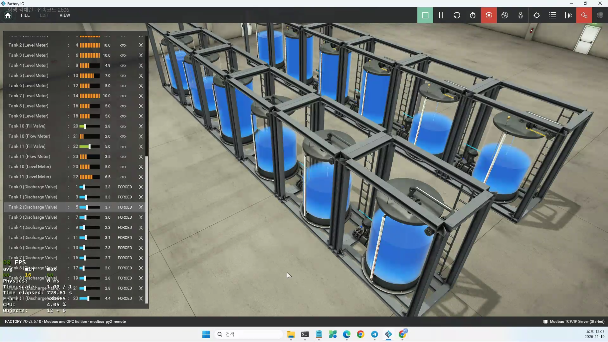
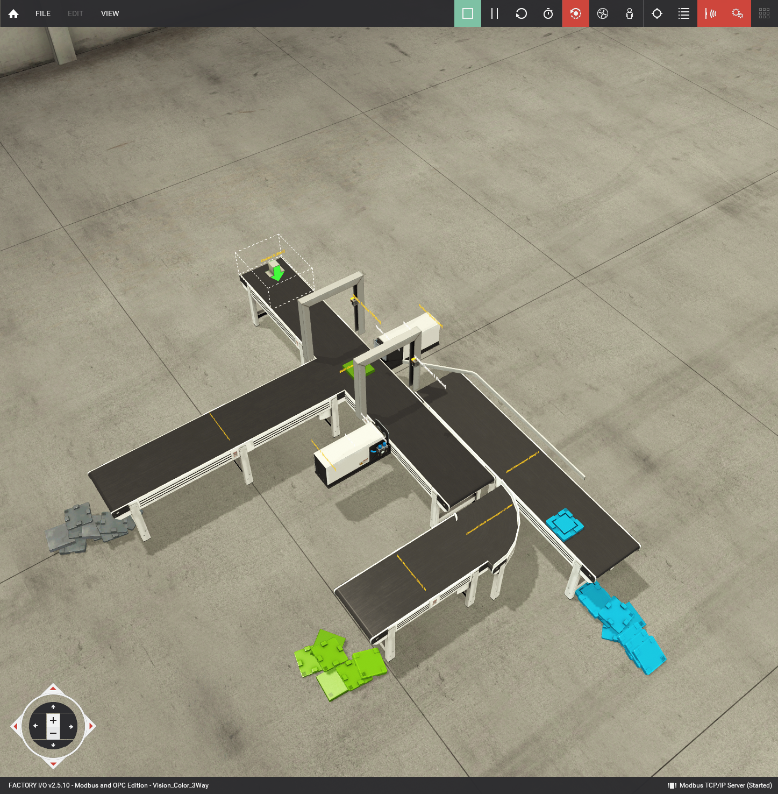

# 2026-11-19 — Factory I/O 워터제어 · 비전 색상 분류

## 파일

| 파일 | 내용 |
| --- | --- |
| [워터제어.ipynb](워터제어.ipynb) | 단일 탱크 급수·배수, 수위 스캔 및 단계별 급수 제어 학습 코드 |
| [Tank8_PI수위제어.ipynb](Tank8_PI수위제어.ipynb) | Tank 8의 수위를 50%로 1시간 제어하는 PI 코드 |
| [tank8_level_50.py](tank8_level_50.py) | 약 50% 도달 시 종료하는 Python 실습 코드. 최대 60초 후 종료 |
| [start-jupyter.ps1](start-jupyter.ps1) | Windows 가상환경의 JupyterLab 실행 |
| [requirements.txt](requirements.txt) | 실습 PC에서 사용한 패키지 버전 |
| [Vision_Color_3Way.ipynb](Vision_Color_3Way.ipynb) | Jupyter에서 실행하는 금속·파랑·초록 3색 분류 |
| [Vision_Color_3Way.py](Vision_Color_3Way.py) | 같은 분류 로직의 Python 실행 파일 |
| [Vision_Color_3Way.factoryio](Vision_Color_3Way.factoryio) | 두 비전 센서·푸셔와 출구 벨트가 매핑된 Factory I/O 장면 |

## 실행 환경

Python 3.13.3을 사용했습니다. `start-jupyter.ps1`의 가상환경은 `C:\cherry\venv`, 노트북 폴더는 `C:\Users\user\Desktop\prac`입니다. 다른 PC에서는 해당 경로를 수정합니다.

```powershell
python -m pip install -r requirements.txt
python -m jupyterlab
```

## 워터제어 실습 화면



Tank 0~11의 수위와 강제 배수 설정을 표시한 실습 화면입니다. Tank 8은 수위 약 50%를 목표로 제어했습니다. 이 사진은 실습 중 한 시점의 화면이며 1시간 전체의 유지 결과를 의미하지 않습니다.

## Tank 8 주소와 배율

사진에 표시된 Factory I/O Modbus TCP/IP Server 매핑을 기준으로 합니다. 서버는 `192.168.0.226:502`, Slave ID는 `1`, Scale은 `100`입니다. IP는 실습 환경에 맞게 수정합니다.

| 역할 | 데이터 영역 | 주소 |
| --- | --- | ---: |
| Tank 8 수위 | Input Register | 16 |
| Tank 8 급수 밸브 | Holding Register | 16 |
| Tank 8 배수 밸브 | Holding Register | 17 |

수위 원시값 `500`은 50%이고, 밸브 명령 `0`은 닫힘, `1000`은 완전 열림입니다. 번호는 장치 주소이며 물의 흐름 방향을 뜻하지 않습니다.

## 1시간 PI 수위 제어

1. Factory I/O에서 위 드라이버·주소 매핑과 시뮬레이션 실행 상태를 확인합니다.
2. `Tank8_PI수위제어.ipynb`의 셀을 실행합니다.
3. 배수 밸브를 닫고 0.2초마다 수위를 읽어, 현재 오차와 누적 오차로 급수량을 계산합니다. P 계수는 `4`, I 계수는 `1.5`이며 명령값을 `0~1000`으로 제한합니다.
4. 목표는 50%, 실행 시간은 `3600`초입니다. 50%에 도달해도 정해진 시간 동안 제어를 계속합니다.
5. 1시간 경과 또는 Jupyter의 중지(■) 시 `finally`에서 두 밸브를 닫는 명령을 보내고 연결을 종료합니다. 통신이 끊기면 닫기 명령 전달 여부를 확인해야 합니다.

강제 소비가 계속되는 환경을 대상으로 합니다. 강제 소비를 중단하고 현재 수위가 목표보다 높으면, 이 코드는 배수 밸브를 열지 않으므로 수위를 능동적으로 낮추지 않습니다. 다른 셀이나 컨트롤러가 같은 주소를 동시에 조작하면 명령이 충돌할 수 있습니다.

실습 중 50% 부근으로 수렴하는 것을 확인했습니다. 1시간 전체의 유지 결과를 기록한 보고서는 아닙니다. 업로드용 노트북에서는 실행 출력과 실행 번호만 정리했으며, 로컬 파일과 실행 중인 커널은 변경하지 않았습니다.

## 비전 센서를 이용한 3색 분류



기존 원재료/제품 OK·NG 분류에서 **색상별 3개 출구 분류**로 변경했습니다. 원재료·뚜껑·베이스의 형태와 관계없이 같은 색은 같은 출구로 보냅니다.

| 색상 | All Numerical 값 | 분류 경로 |
| --- | --- | --- |
| 금속(회색) | 7, 8, 9 | 첫 번째 비전 → 푸셔 0 → 금속 배출 벨트 |
| 파랑 | 1, 2, 3 | 첫 번째 분기 통과 → 두 번째 비전 → 푸셔 1 → 파랑 배출 벨트 |
| 초록 | 4, 5, 6 | 두 푸셔 통과 → 곡선 벨트 → 초록 배출 벨트 |

비전 값 `0`은 부품 없음입니다. 숫자 인코딩은 [Factory I/O 공식 비전 센서 문서](https://docs.factoryio.com/manual/parts/sensors/#vision-sensor)를 기준으로 하며, 색상 ID에 Scale 100을 나누지 않습니다.

### 실행 방법

1. Factory I/O에서 `Vision_Color_3Way.factoryio`를 엽니다.
2. Modbus TCP/IP Server 드라이버를 시작합니다. 코드의 기본 서버는 `192.168.0.16:502`, Slave ID는 `1`입니다. 워터제어 서버와 IP가 다르므로 실행 환경에 맞게 `HOST`를 수정합니다.
3. Jupyter에서 `Vision_Color_3Way.ipynb`의 정의 셀과 실행 셀을 순서대로 실행합니다.
4. 실행 셀의 `duration=60`은 60초 실행을 의미합니다. 최대 3600초까지 지정할 수 있습니다. 중간 중지는 Jupyter의 **■ Interrupt** 버튼입니다.

Python 파일로도 실행할 수 있습니다.

```powershell
python Vision_Color_3Way.py --seconds 120
```

두 실행 방식을 동시에 실행하면 같은 출력 주소를 조작하므로 한 가지 방식만 실행합니다.

### Modbus 주소

| 역할 | 영역 | 주소 |
| --- | --- | --- |
| 첫 번째 / 두 번째 비전 숫자값 | Input Register | 0 / 1 |
| 푸셔 0 복귀 / 전진 완료 | Discrete Input | 0 / 1 |
| Factory I/O Run 상태 / Reset 상태 | Discrete Input | 2 / 3 |
| 푸셔 1 복귀 / 전진 완료 | Discrete Input | 4 / 5 |
| 메인 벨트 / 금속 배출 벨트 | Coil | 0 / 1 |
| Emitter / 푸셔 0 / 푸셔 1 | Coil | 2 / 3 / 4 |
| 곡선 / 파랑 배출 / 초록 배출 벨트 | Coil | 5 / 6 / 7 |
| Factory I/O Run 명령 | Coil | 8 |

### 수정 내용과 검증

- 두 번째 All Numerical 비전 센서를 추가하고 IR1에 연결했습니다.
- Emitter가 파랑·초록·금속의 원재료·뚜껑·베이스를 생성하도록 설정했습니다.
- 얇은 부품도 밀 수 있도록 두 푸셔 높이를 조정했습니다.
- 금속과 초록 배출 벨트가 분기점으로 되돌아가던 방향을 바깥 방향으로 변경했습니다.
- 감지 후 0.2초 이송 → 메인 벨트 정지 → 푸셔 전진 완료 → 0.3초 유지 → 복귀 완료 → 이송 재개 순서로 제어합니다. 다른 푸셔 동작 중 멈춘 시간은 부품 이송 시간에 포함하지 않습니다.
- 센서가 0으로 돌아온 뒤 다음 부품을 판정해 중복 감지를 줄이고, 전진·복귀는 각각 3초 안에 완료되지 않으면 정지합니다.

120초 연속 시험은 금속 **8개**, 파랑 **6개**, 초록 **3개**로 오류 없이 종료했습니다. 이어 Jupyter에서 60초 실행해 금속 **1개**, 파랑 **4개**, 초록 **4개**를 처리했습니다. 두 시험에서 비전 값 1~9를 모두 확인했고, 사진처럼 세 출구의 색상 분리를 확인했습니다.

집계는 금속·파랑의 푸셔 복귀와 초록의 두 번째 센서 통과 기준입니다. 최종 낙하 위치에 별도 계수 센서는 없습니다. 시간 제한에 도달하면 진행 중인 단계와 관계없이 발생기·벨트·푸셔 출력을 끄므로 마지막 부품은 집계에서 제외될 수 있습니다. 업로드용 노트북의 실행 출력은 정리했습니다.
