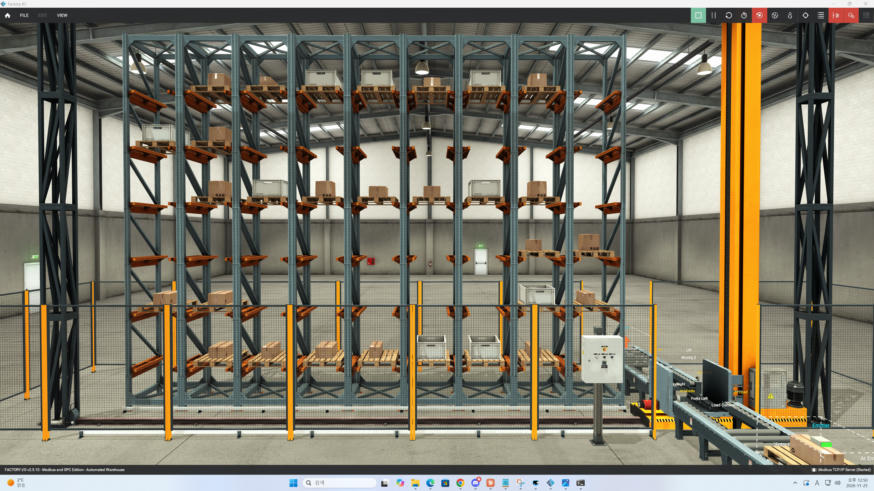

# 2026-11-25 실습 — 스태커 크레인 S자 적재

Factory I/O `Automated Warehouse` 씬(랙 9×6)을 Modbus TCP 서버로 두고, Jupyter(pymodbus 3.x, `device_id`)에서 스태커 크레인을 제어해 랙에 알파벳 S 모양(29칸)으로 적재합니다.

- [StackerCrane_S_PLAN.md](StackerCrane_S_PLAN.md): 구현 계획서 (IO 맵, 위치 번호 규칙, 시퀀스, 실측 결과)
- [StackerCrane_S.ipynb](StackerCrane_S.ipynb): 제어 노트북
- [StackerCrane_S.factoryio](StackerCrane_S.factoryio): Factory I/O 씬 (드라이버 매핑 포함)
- [fake_factoryio_server.py](fake_factoryio_server.py): Factory I/O 없이 시험하는 가짜 Modbus 서버
- [FactoryIO_S결과.jpg](FactoryIO_S결과.jpg): 적재 결과 화면

